<p align="center">
  
</p>

<p align="center">
  <a href="https://nextjs.org"></a>
  <a href="https://react.dev"></a>
  <a href="https://tailwindcss.com"></a>
  <a href="https://www.typescriptlang.org"></a>
  
  
  
  
</p>

---

## Overview

**Hairline UI** is an architectural, Swiss-rationalist design system and component library built with **Next.js 16 (Turbopack)**, **React 19**, **Tailwind CSS v4**, and **TypeScript**. 

Every component is modeled as a physical **"Plate"** inspired by historical drawing offices, railway control rooms, teletype terminals, darkrooms, and typesetting cases.

- **Zero Runtime Dependencies**: Every single animation is crafted with native CSS variables, cubic-bezier timing curves, or direct SVG geometry.
- **Physical Metaphor System**: Every plate embodies one physical verb (`tear`, `punch`, `measure`, `scrub`, `weigh`, `strike`).
- **Complete A11y & Reduced Motion**: Keyboard accessible, full ARIA roles, and instant state communication under `prefers-reduced-motion`.
- **Machine-Readable API**: Standalone self-contained source code and full specification prompts available via live registry endpoints.

<p align="center">
  
</p>

---

## Quick Start

### 1. Installation

```bash
git clone https://github.com/shauryap9006-cell/componets.git
cd componets
npm install
```

### 2. Development Server

```bash
npm run dev
```

Visit [http://localhost:3000](http://localhost:3000) to explore the interactive component workshop, plates gallery, and inspector.

### 3. Production Build & Static Generation

```bash
# Provide DATABASE_URL for build-time static route collection
$env:DATABASE_URL="postgres://localhost:5432/hairline"
npm run build
```

---

## Machine-Readable Registry API

Each of the **107 plates** provides a zero-dependency, self-contained single-file bundle that can be copied directly into any React 19 + Tailwind project:

```bash
# Fetch self-contained source code for any plate
curl http://localhost:3000/api/registry/countdown-toast
curl http://localhost:3000/api/registry/patch-bay
curl http://localhost:3000/api/registry/caliper-slider
```

Every registry response returns:
1. JSDoc specification header with authors, tokens, and world context.
2. The component implementation code.
3. Live usage snippet with currently applied settings.
4. Embedded `@/kit/act` interaction hooks (`useAct`, `useTick`, `rng`).

---

## Component Catalog (107 Plates)

<details open>
<summary><b>1. Buttons, Confirmations & Toggles (Figs 001–006, 015–016, 038–039, 042–045, 085)</b></summary>

| Fig | Slug | Name | World | Verb | Variants |
| :---: | :--- | :--- | :--- | :--- | :--- |
| **001** | `perforated-tear` | Perforated Tear | Post Office | `tear` | `Ticket` (Admission ticket) |
| **002** | `postmark` | Postmark | Post Office | `cancel` | — |
| **003** | `envelope-flap` | Envelope Flap | Post Office | `tuck` | `Pocket` (Pocket dispatch) |
| **004** | `arrow-relay` | Arrow Relay | Railway | `switch` | — |
| **006** | `ticket-punch` | Ticket Punch | Railway | `punch` | `Manifest` (Customs checklist) |
| **015** | `shutter-toggle` | Aperture Switch | Darkroom | `expose` | — |
| **016** | `spirit-level` | Spirit Level | Instrument Lab | `level` | — |
| **038** | `rubber-stamp` | Rubber Stamp | Customs & Bureaucracy | `stamp` | — |
| **039** | `signal-lever` | Signal Lever | Railway | `throw` | — |
| **042** | `queue-ticket` | Queue Ticket | Post Office | `dispense` | — |
| **043** | `postage-meter` | Postage Meter | Post Office | `frank` | — |
| **044** | `safety-interlock` | Safety Interlock | Control Room | `arm` | — |
| **045** | `signal-lamp` | Signal Lamp | Railway | `signal` | — |
| **085** | `tear-card` | Contact Tear Card | Post Office | `tear` | — |

</details>

<details open>
<summary><b>2. Loaders, Time & Chronometry (Figs 005, 009, 020, 026, 029, 046–057)</b></summary>

| Fig | Slug | Name | World | Verb | Variants |
| :---: | :--- | :--- | :--- | :--- | :--- |
| **005** | `split-flap` | Split-Flap | Railway | `flip` | `Clock` (Station clock) |
| **009** | `ink-pull` | Ink Pull | Print Shop | `pull` | `Dither` (Bayer dither pull) |
| **020** | `due-date-slip` | Due Date Slip | Library & Archive | `date` | — |
| **026** | `metronome` | Metronome | Music Studio | `swing` | — |
| **029** | `barcode-scan` | Barcode Scan | Customs & Bureaucracy | `scan` | — |
| **046** | `counting-preloader`| Counting Preloader | Control Room | `count` | — |
| **047** | `line-draw-loader` | Line Draw Loader | Drawing Office | `draw` | — |
| **048** | `dot-wave-loader` | Dot Wave Loader | Instrument Lab | `oscillate` | — |
| **049** | `clock-hand-loader` | Clock Hand Loader | Railway | `tick` | — |
| **050** | `block-cursor-loader`| Terminal Cursor | Control Room | `blink` | — |
| **051** | `sundial-clock` | Sundial Clock | Observatory & Weather | `cast` | — |
| **052** | `star-chart` | Star Chart | Observatory & Weather | `chart` | — |
| **053** | `analog-clock` | Swiss Station Clock | Railway | `tick` | — |
| **054** | `seven-segment` | Seven Segment LED | Control Room | `glow` | — |
| **055** | `stopwatch` | Split Chronograph | Instrument Lab | `time` | — |
| **056** | `ticker-clock` | Ticker Time Tape | Railway | `scroll` | — |
| **057** | `film-leader` | SMPTE Film Leader | Darkroom | `countdown` | — |

</details>

<details open>
<summary><b>3. Selectors, Sliders & Inputs (Figs 010–012, 014, 018–019, 024–025, 028, 030, 058–064, 106)</b></summary>

| Fig | Slug | Name | World | Verb | Variants |
| :---: | :--- | :--- | :--- | :--- | :--- |
| **010** | `caliper-slider` | Caliper Slider | Drawing Office | `measure` | `Ruler` (Drafting desk rule) |
| **011** | `dimension-input` | Dimension Input | Drawing Office | `dimension` | `Drafting` (Architectural line) |
| **012** | `section-cut` | Section Cut | Drawing Office | `cut` | — |
| **014** | `contact-sheet` | Grease Pencil | Darkroom | `circle` | `Tabs` (Film strip tabs) |
| **018** | `detent-knob` | Detent Knob | Instrument Lab | `tune` | `Dial` (Continuous radio dial) |
| **019** | `index-drawer` | Index Drawer | Library & Archive | `file` | `Cabinet` (Oak card catalogue) |
| **024** | `odometer` | Odometer | Control Room | `roll` | — |
| **025** | `fader` | Channel Fader | Music Studio | `ride` | `Bank` (3-channel console bank) |
| **028** | `comb-field` | Comb Field | Customs & Bureaucracy | `fill` | — |
| **030** | `strike-out` | Strike Out | Customs & Bureaucracy | `strike` | — |
| **058** | `patch-bay` | Patch Bay | Music Studio | `patch` | — |
| **059** | `teleprinter` | Teleprinter | Customs & Bureaucracy | `feed` | — |
| **060** | `scrubbable-number` | Scrubbable Number | Drawing Office | `scrub` | — |
| **061** | `combination-lock` | Combination Lock | Control Room | `dial` | — |
| **062** | `protractor` | Drafting Protractor | Drawing Office | `measure` | — |
| **063** | `file-dropzone` | Negative Dropzone | Darkroom | `inspect` | — |
| **064** | `shortcut-recorder`| Shortcut Keycap | Control Room | `capture` | — |
| **106** | `punch-card` | IBM 80-Column Punch | Control Room | `punch` | — |

</details>

<details open>
<summary><b>4. Typography, Print & Media (Figs 007–008, 013, 034–037, 065–084)</b></summary>

| Fig | Slug | Name | World | Verb | Variants |
| :---: | :--- | :--- | :--- | :--- | :--- |
| **007** | `misregister` | Misregister | Print Shop | `misregister` | `Heading` (Editorial title) |
| **008** | `halftone-dial` | Halftone Screen | Print Shop | `screen` | `Avatar` (Halftone portrait) |
| **013** | `develop` | Developer Tray | Darkroom | `develop` | — |
| **034** | `composing-stick` | Composing Stick | Typesetter’s Case | `set` | — |
| **035** | `kerning-pair` | Kerning Pair | Typesetter’s Case | `kern` | — |
| **036** | `width-axis` | Width Axis | Typesetter’s Case | `stretch` | `Specimen` (Multi-weight card) |
| **037** | `moire-field` | Moiré Field | Print Shop | `interfere` | — |
| **065** | `scramble-decode` | Scramble Decoder | Typesetter’s Case | `decode` | — |
| **066** | `rolling-numerals` | Rolling Numerals | Control Room | `roll` | — |
| **067** | `outline-numerals` | Stencil Numerals | Drawing Office | `stencil` | — |
| **068** | `running-head` | Running Head | Library & Archive | `folio` | — |
| **069** | `ticker-tape` | Ticker Tape | Customs & Bureaucracy | `stream` | — |
| **070** | `kerning-rope` | Elastic Kerning | Typesetter’s Case | `tension` | — |
| **071** | `redline-diff` | Redline Strike | Customs & Bureaucracy | `revise` | — |
| **072** | `misregistration-text`| CMYK Shift | Print Shop | `separate` | — |
| **073** | `sparkwords` | Sparkline Glyph | Drawing Office | `spark` | — |
| **074** | `type-on-grid` | Modular Type Grid | Drawing Office | `coordinate` | — |
| **075** | `dither-image` | Bayer Screen Dither | Darkroom | `disperse` | — |
| **076** | `ascii-image` | Raster Matrix | Control Room | `raster` | — |
| **077** | `scan-line-reveal` | Cathode Scan | Control Room | `sweep` | — |
| **078** | `before-after` | Proof Wiper | Darkroom | `compare` | — |
| **079** | `waveform-player` | Tape Head Scrubber | Music Studio | `play` | — |
| **080** | `perforated-frame` | Film Rebate | Darkroom | `expose` | — |
| **081** | `small-multiples` | Tufte Multiples | Drawing Office | `compare` | — |
| **082** | `risograph-image` | Dual Drum Riso | Print Shop | `drum` | — |
| **083** | `letterpress` | Letterpress Deboss | Print Shop | `deboss` | — |
| **084** | `crop-frame` | Drafting Crop | Darkroom | `crop` | — |

</details>

<details open>
<summary><b>5. Data Visualization, Indicators & Overlays (Figs 017, 021–023, 027, 031–033, 040–041, 086–105, 107)</b></summary>

| Fig | Slug | Name | World | Verb | Variants |
| :---: | :--- | :--- | :--- | :--- | :--- |
| **017** | `needle-gauge` | Needle Gauge | Instrument Lab | `weigh` | `Dual` (Dual comparator) |
| **021** | `dotted-leader` | Dotted Leader | Library & Archive | `lead` | — |
| **022** | `elastic-rule` | Elastic Rule | Library & Archive | `stretch` | — |
| **023** | `annunciator` | Annunciator | Control Room | `acknowledge` | `Matrix` (4x4 matrix board) |
| **027** | `step-sequencer` | Step Sequencer | Music Studio | `step` | — |
| **031** | `barograph` | Barograph | Observatory & Weather | `plot` | `Drum` (Cylindrical drum) |
| **032** | `compass-bearing` | Bearing | Observatory & Weather | `orient` | — |
| **033** | `moon-phase` | Moon Phase | Observatory & Weather | `wax` | — |
| **040** | `plotter-sparkline`| Plotter Sparkline | Drawing Office | `trace` | — |
| **041** | `tally-counter` | Tally Counter | Control Room | `tally` | — |
| **086** | `dossier` | Dossier String Tie | Customs & Bureaucracy | `unwind` | — |
| **087** | `aperture-tip` | Iris Tooltip | Darkroom | `expand` | — |
| **088** | `declaration-dialog`| Manifest Modal | Customs & Bureaucracy | `manifest` | — |
| **089** | `heatmap-calendar` | Calendar Matrix | Library & Archive | `map` | — |
| **090** | `typographic-bars` | Typographic Bars | Drawing Office | `measure` | — |
| **091** | `line-chart-scrub` | Scrubbable Trendline| Drawing Office | `scrub` | — |
| **092** | `radial-tick-gauge` | Radial Tachometer | Control Room | `sweep` | — |
| **093** | `dumbbell-chart` | Dumbbell Comparison | Drawing Office | `span` | — |
| **094** | `hairline-treemap` | Hairline Treemap | Drawing Office | `partition` | — |
| **095** | `ribbon-flow` | Alluvial Ribbon | Drawing Office | `flow` | — |
| **096** | `leaderboard-flip` | Flap Leaderboard | Railway | `rank` | — |
| **097** | `live-ticker-table` | Exchange Matrix | Customs & Bureaucracy | `quote` | — |
| **098** | `hatching-chart` | Monochrome Hatch Bar| Print Shop | `hatch` | — |
| **099** | `isometric-stack` | Axonometric Cube | Drawing Office | `project` | — |
| **100** | `bullet-graph` | Few Bullet Graph | Drawing Office | `evaluate` | — |
| **101** | `slopegraph` | Trajectory Slopegraph| Drawing Office | `incline` | — |
| **102** | `bauhaus-generator` | Bauhaus Generator | Print Shop | `generate` | — |
| **103** | `flow-field` | Vector Flow Field | Observatory & Weather | `trace` | — |
| **104** | `seismograph` | Tremor Seismograph | Observatory & Weather | `tremble` | — |
| **105** | `vu-meter` | Analog VU Meter | Music Studio | `ballistic` | — |
| **107** | `countdown-toast` | Perimeter Toast | Customs & Bureaucracy | `expire` | — |

</details>

---

## Design System Tokens & Contract

Hairline UI components are governed by CSS custom properties and pure design tokens:

```css
:root {
  --paper: #f8fafc;           /* Light canvas */
  --ink: #0f172a;             /* Dark drawing ink */
  --plate: #f1f5f9;           /* Secondary plate surface */
  --acc: #ef4444;             /* Single accent color */
  --ln: 1px;                  /* Precision hairline border thickness */
  --rad: 0px;                 /* Square architectural corners */
  --sp: 1;                    /* Universal speed multiplier */
  --ez: cubic-bezier(0.16, 1, 0.3, 1); /* Natural mechanical easing */
}

@media (prefers-color-scheme: dark) {
  :root {
    --paper: #0b0d10;
    --ink: #f3f4f6;
    --plate: #13171f;
    --acc: #ef4444;
  }
}
```

### Eight Moment States

Every plate responds predictably to the 8 standard interface moments:
- `rest`: Neutral resting state.
- `over`: Hover or pointer tracking state.
- `pressed`: Mechanical give / active depressed state.
- `keyboard`: Focus-visible state with 2px square accent outline.
- `busy`: Dot ticker / oscillating sweep loader.
- `done`: Permanent confirmed/valid state.
- `problem`: Accent-highlighted error state with explanatory readout.
- `off`: Inert, 40% opacity resting state.

---

## Quality Verification

Run the full automated verification test suite:

```bash
# TypeScript compiler typecheck
npm run typecheck

# Code quality & React Compiler ESLint audit
npx eslint src/demos/*.tsx

# Production static site generation test (115 routes)
$env:DATABASE_URL="postgres://localhost:5432/hairline"; npm run build
```

---

## License

MIT © [Shaurya](https://github.com/shauryap9006-cell)
